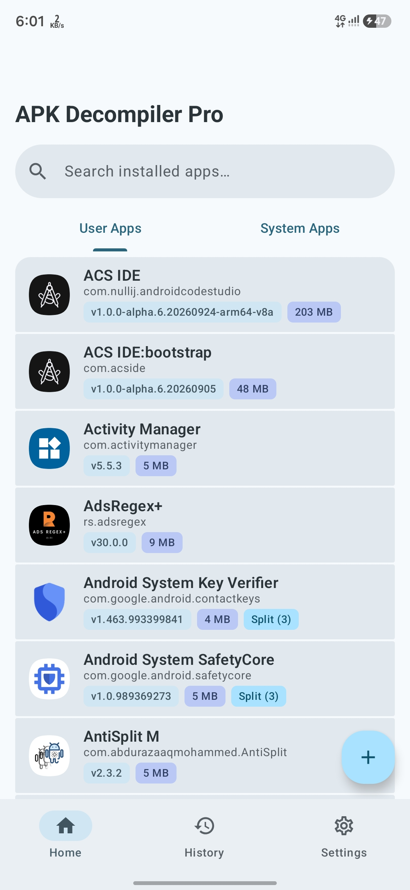
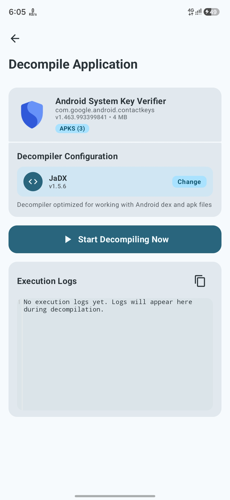
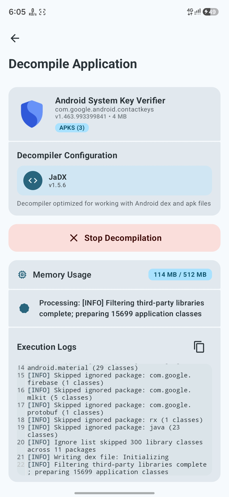
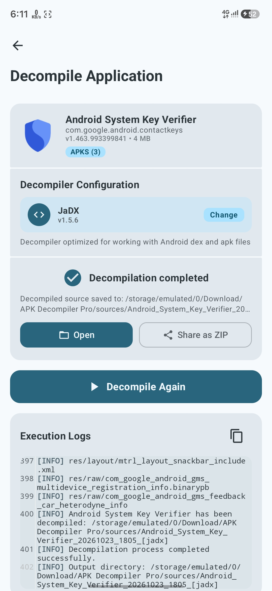
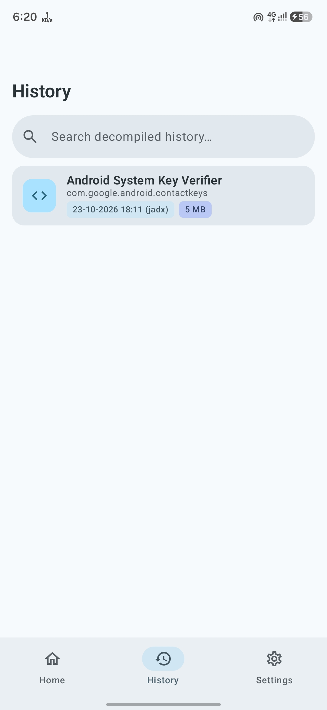
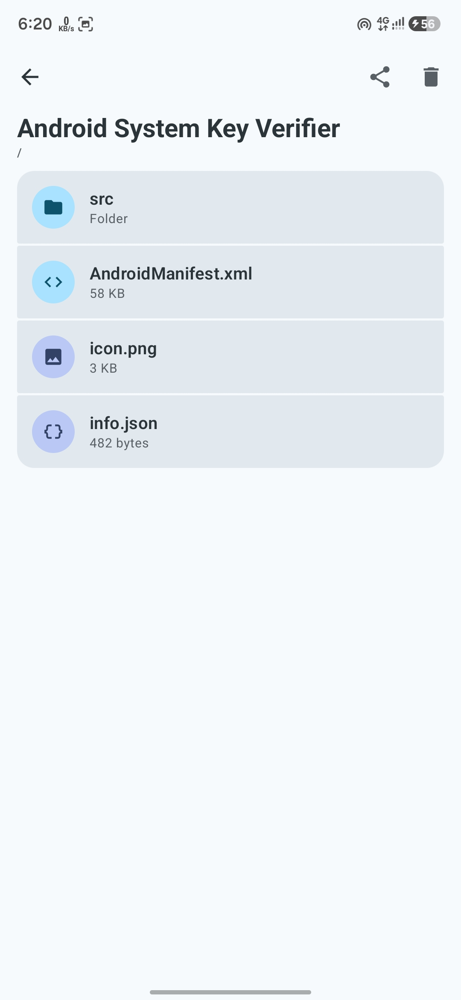
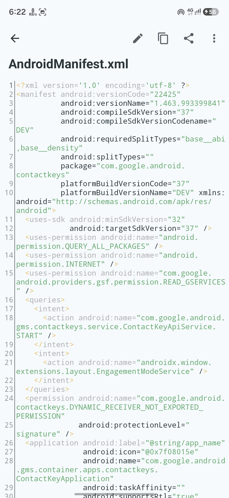
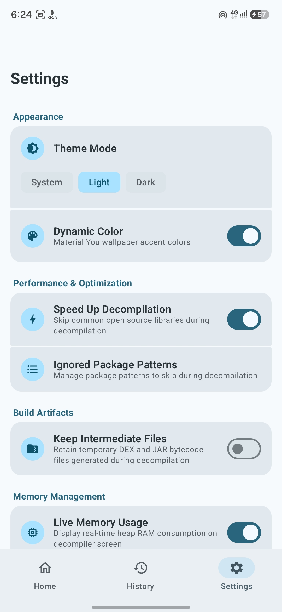

# APK Decompiler Pro

### Decompile, Explore & Inspect Android Apps

An open-source Android toolkit for decompiling, extracting, and inspecting APKs, split APK bundles, DEX bytecode, and JAR files directly on your device.

---

## ✨ Key Features

APK Decompiler Pro brings a complete Android decompilation and source-inspection workflow to your phone or tablet, without requiring a computer.

### 🔍 App Browsing & Package Extraction

- **User & System Apps:** Browse, search, and filter installed user apps and pre-installed system apps.
- **APK & APKS Extraction:** Extract an installed app's original APK or split APKS bundle to your Downloads folder.
- **Share Packages:** Share extracted APK or APKS files with other apps.
- **External File Picker:** Select `.apk`, `.apks`, `.xapk`, `.dex`, and `.jar` files from device storage.

### ⚙️ Multi-Engine Decompilation

- **Multiple Decompiler Engines:** Choose between JaDX, CFR, Procyon, and FernFlower.
- **Java Source & XML Resources:** Inspect decompiled Java source code, `AndroidManifest.xml`, layout XML, drawables, values, and other application resources.
- **Ignore Library Packages:** Skip common third-party open-source libraries to speed up decompilation, with editable and resettable ignore patterns.
- **Keep Intermediate Files:** Optionally retain generated `.dex` and `.jar` files alongside the decompiled output.
- **Memory Controls:** Use automatic memory scaling or set a manual memory limit from `512 MB` to `8 GB`.
- **Live RAM Monitor:** View memory consumption while decompilation is running.

### 🧰 Source Explorer & Code Editor

- **Built-in Source Explorer:** Browse decompiled folders and files, with file-size indicators.
- **File Actions:** Open, share, delete, or launch files in external apps.
- **Syntax Highlighting:** Read source files with syntax highlighting and line numbers.
- **Editor Controls:** Toggle word wrap, pinch to zoom, search within files, copy code, and save edits directly.

### 📚 History, Logs & ZIP Export

- **Decompilation History:** Review previously decompiled apps and see which engine was used.
- **ZIP Export:** Compress and share a complete decompiled source project as a `.zip` archive.
- **Background Processing:** Continue decompilation while using other apps, with progress notifications.
- **Live Execution Logs:** Follow automatically scrolling logs and copy log output.
- **Stop Control:** Stop an active process from the app or notification. Files already generated are preserved as partial output.

### 🎨 Material 3 & Settings

- **System, Light & Dark Themes:** Choose the appearance that suits your device.
- **Material You Dynamic Colors:** Toggle wallpaper-based dynamic colors.
- **Custom Working Directory:** Choose a storage folder for decompiled projects or reset to the default directory.
- **Flexible Settings:** Configure ignored library patterns, intermediate-file retention, live memory usage, and memory limits.
- **In-App Updates:** Check GitHub for new releases, read release notes, and download the latest APK update.
- **Multi-language Support:** Available in English, Arabic, German, Spanish, French, Portuguese, Russian, Turkish, and Chinese.

---

## 🎨 Material 3 Expressive UI

APK Decompiler Pro is designed to provide a modern and consistent Android experience.

- **Material 3 Expressive:** A modern interface with a clear, focused workflow.
- **Dynamic Colors:** Optional adaptation to your system wallpaper color palette.
- **Light & Dark Themes:** Choose System, Light, or Dark mode.
- **Progress & Execution Logs:** Track decompilation progress and inspect execution details.
- **Responsive Workflow:** Browse apps, manage files, and inspect source code directly on your Android device.

---

## 📸 Screenshots

---

## ☕ Support the Project

If APK Decompiler Pro is useful to you, you can support its continued development by buying me a coffee.

 

---

## 🙏 Acknowledgements

Special thanks to the **ACS Lite team** for making Android development possible directly on mobile.

This project was developed using ACS Lite, allowing the application to be built on an Android device without a computer.

 

---

## 📄 License

This project is licensed under the [GNU General Public License v3.0](./LICENSE).
